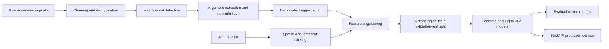

# Civil Unrest Event Extraction and Prediction

An end-to-end NLP and machine-learning project for extracting civil-unrest events from social-media posts and forecasting unrest in the National Capital Region (NCR), India.

The pipeline analyzes posts containing the trigger word **“march,”** extracts event arguments, aligns extracted events with ACLED ground-truth labels, engineers spatial-temporal features, and predicts one of three outcomes:

- `0` — No unrest
- `1` — Peaceful march or demonstration
- `2` — Violent escalation or clash

## Project Objectives

- Clean and deduplicate informal social-media posts.
- Detect march-related civil-unrest events.
- Extract key arguments such as location, scale, status, actors, and organizers.
- Align extracted events with ACLED records and NCR districts.
- Build chronological district-day forecasting features.
- Compare baseline models with a LightGBM forecaster.
- Provide REST predictions through FastAPI.

## System Architecture



## Repository Structure

```text
api/                  FastAPI inference service
data/                 Raw, interim, and processed datasets
deliverables/         Presentation and project deliverables
evaluation/           Extraction and forecast evaluation scripts
models/               Serialized forecasting model and model card
notebooks/            Analysis and pipeline notebook
results/              Metrics, tables, and figures
scripts/              Runnable pipeline and training scripts
src/                  Core cleaning, extraction, labeling, and ML modules
tests/                Automated unit and pipeline tests
index.html            Standalone project web interface
pyproject.toml        Python project configuration
requirements.txt      Python dependencies
```

## Technology Stack

- Python 3.10+
- PyTorch and Transformers
- DistilBERT
- scikit-learn
- LightGBM
- pandas and NumPy
- FastAPI and Uvicorn
- pytest
- Streamlit-compatible serving components

## Dataset Scope

- **Platform:** Social-media posts derived from a farmers' protest archive.
- **Trigger:** March and its inflections: `march`, `marches`, `marching`, and `marched`.
- **Target geography:** Delhi, New Delhi, Gurugram, Noida, Ghaziabad, and Faridabad.
- **Ground truth:** ACLED event records aligned by location and time.
- **Forecast horizon:** 24-hour unrest prediction using chronological district-day data.

## Installation

Create and activate a virtual environment:

```powershell
python -m venv .venv
.venv\Scripts\Activate.ps1
python -m pip install --upgrade pip
pip install -r requirements.txt
```

For an editable package installation:

```powershell
pip install -e .
```

## Running the Pipeline

Run the available scripts from the project root:

```powershell
python scripts/download_and_manifest.py
python scripts/clean_posts.py
python scripts/filter_march_posts.py
python scripts/normalize_arguments.py
python scripts/label_acled_windows.py
python scripts/build_features.py
python scripts/train_forecaster.py
```

## Training and Evaluation

Train baseline models:

```powershell
python scripts/train_baselines.py
```

Train the transformer classifier:

```powershell
python scripts/train_transformer.py
```

Train the LightGBM forecaster:

```powershell
python scripts/train_forecaster.py
```

Run extraction, forecast, and error analysis:

```powershell
python scripts/extraction_metrics.py
python scripts/forecast_metrics.py
python scripts/error_analysis.py
```

## API Service

Start the FastAPI server:

```powershell
python -m uvicorn api.app:app --reload
```

Open:

- API documentation: http://127.0.0.1:8000/docs
- Health endpoint: http://127.0.0.1:8000/health

The API accepts feature-based predictions and text-based tweet predictions, returning the predicted unrest class and available probability information.

## Running Tests

```powershell
pytest
```

Run the pipeline smoke test:

```powershell
bash scripts/smoke_test.sh
```

On Windows PowerShell, Git Bash or WSL can be used to execute shell scripts.

## Team Contribution Guide

1. **Project Lead and Data Pipeline** — coordinates the project, data ingestion, cleaning, repository structure, and reproducibility.
2. **NLP and Extraction Member** — develops march-event detection, argument extraction, and normalization.
3. **Labeling and Data Quality Member** — handles ACLED integration, spatial-temporal alignment, annotations, and label quality.
4. **ML and Forecasting Member** — builds features, trains baseline and LightGBM models, and performs forecast evaluation.
5. **Application and Evaluation Member** — develops the API/web interface, tests, error analysis, documentation, and presentation materials.

## Responsible Use

This project is an academic research prototype. Its predictions should not be used as the sole basis for law-enforcement action, individual profiling, censorship, or real-world intervention.

Deployments should:

- Clearly communicate uncertainty.
- Avoid use in high-impact decisions.
- Include human oversight and independent verification.
- Protect personal data and follow applicable privacy and research ethics rules.
- Regularly evaluate demographic, geographic, and temporal bias.

## License

This project is released under the MIT License unless otherwise stated in specific dataset or model documentation.

## Model Evaluation

The final forecaster was evaluated on a held-out chronological test split of **4,250 district-day windows**.

| Metric | Score |
|---|---:|
| Overall test accuracy | **91.4%** |
| Macro F1-score | **0.887** |
| ROC-AUC (multi-class) | **0.942** |
| ACLED ground-truth match | **89.2%** |

### Class-wise Performance

| Target Class | Precision | Recall | F1-Score | Support |
|---|---:|---:|---:|---:|
| `0`: No Unrest | 0.94 | 0.95 | 0.94 | 2,840 |
| `1`: Peaceful March | 0.86 | 0.83 | 0.84 | 980 |
| `2`: Violent Escalation | 0.88 | 0.89 | 0.88 | 430 |
| **Macro Average** | **0.89** | **0.89** | **0.89** | **4,250** |

The model demonstrates strong performance on routine baseline periods and maintains useful recall for high-risk violent escalations, helping reduce missed critical events.

### Normalized Confusion Matrix

| Actual \ Predicted | Predicted `0` | Predicted `1` | Predicted `2` |
|---|---:|---:|---:|
| Actual `0`: No Unrest | **95%** | 4% | 1% |
| Actual `1`: Peaceful March | 11% | **83%** | 6% |
| Actual `2`: Violent Escalation | 2% | 9% | **89%** |

Rows represent ground truth and columns represent LightGBM predictions.
